# MERIDIAN Architecture

MERIDIAN is the SQL-generation and backend-data-validation worker for healthcare support tickets. It packages the BECU deterministic SQL-generation core inside `cp-autonomous-ai-agents-platform`, adds Jira ingestion, DB target resolution, SSM/local tunnel connectivity, PHI-safe validation, and human-review output.

```mermaid
flowchart LR
    subgraph Inputs["Ticket Inputs"]
        Jira["Jira ticket<br/>summary, description, comments"]
        Attachments["Jira attachments<br/>Excel / CSV / screenshots"]
        Operator["Support engineer<br/>label or cockpit run"]
    end

    subgraph Platform["cp-autonomous-ai-agents-platform"]
        Orchestrator["Task orchestrator<br/>Jira polling + assignment"]
        Cockpit["Investigation Cockpit<br/>optional run UI"]
        MeridianWorker["MERIDIAN worker<br/>packaged backend runner"]
        TargetRegistry["Target registry<br/>client, env, DB target"]
        Secrets["Secrets / parameters<br/>DB user, role ARN, host metadata"]
    end

    subgraph MeridianCore["MERIDIAN Core Engine"]
        Parser["Ticket + attachment parser<br/>deterministic first"]
        LLMExtractor["LLM extraction fallback<br/>metadata/redacted only"]
        Mapper["Mapping engine<br/>BECU deterministic modules<br/>YAML + XLSX + DB config"]
        Validator["Read-only DB validator<br/>record lookup, FK resolution,<br/>already-done checks, PHI guards"]
        SqlGen["SQL generator<br/>Backup -> Update/Delete -> Audit -> Validate"]
        Guardrails["Safety guardrails<br/>no execution, delete allowlist,<br/>PHI redaction, human approval"]
    end

    subgraph Connectivity["Database Connectivity"]
        SSM["SSM port forward<br/>deployed worker path"]
        LocalTunnel["Local tunnel<br/>developer test path"]
        ClientDB["Client DB / replica<br/>read-only validation"]
    end

    subgraph Evidence["Optional Evidence Agents"]
        CodeAgent["Code Agent<br/>code-path evidence"]
        Watchdog["Watchdog<br/>CloudWatch/log evidence"]
    end

    subgraph Outputs["Outputs"]
        SqlFile["Generated SQL file<br/>human-reviewable"]
        JiraComment["Jira summary comment<br/>redacted findings"]
        DBA["DBA / human approver<br/>executes outside MERIDIAN"]
        AuditTrail["Audit trail<br/>Jira + CloudWatch + CloudTrail"]
    end

    Operator --> Cockpit
    Jira --> Orchestrator
    Attachments --> Orchestrator
    Orchestrator --> MeridianWorker
    Cockpit --> MeridianWorker

    MeridianWorker --> Parser
    Parser --> Mapper
    Parser -.only when deterministic parsing is insufficient.-> LLMExtractor
    LLMExtractor --> Mapper
    Mapper --> Validator
    Validator --> Guardrails
    Guardrails --> SqlGen

    MeridianWorker --> TargetRegistry
    TargetRegistry --> Secrets
    TargetRegistry --> SSM
    TargetRegistry --> LocalTunnel
    SSM --> ClientDB
    LocalTunnel --> ClientDB
    Validator <-->|SELECT only| ClientDB

    CodeAgent -.sidecar evidence.-> MeridianWorker
    Watchdog -.sidecar evidence.-> MeridianWorker

    SqlGen --> SqlFile
    SqlGen --> JiraComment
    SqlFile --> DBA
    JiraComment --> DBA
    DBA -.manual execution only.-> ClientDB
    MeridianWorker --> AuditTrail
    SSM --> AuditTrail
```

## Architecture Rules

- MERIDIAN uses deterministic BECU-derived modules first; the LLM is a fallback for extraction or unknown-schema reasoning, not the primary SQL authority.
- MERIDIAN validates against the database with read-only access before generating SQL, but it never executes update/delete statements.
- Deployed workers use SSM port forwarding when approved; local testing can use an existing local tunnel on `localhost:<port>`.
- PHI/PII may exist in Jira, attachments, and DB rows, but prompts, logs, Jira comments, and summaries must be redacted.
- The final write path remains outside MERIDIAN through DBA/human approval.

## Packaged Backend Hardening

Packaged MERIDIAN mode must treat the embedded FastAPI backend as an internal
worker component, not a general developer tool. Before pilot or production use,
the packaged backend controls must be hardened and evidenced.

Required packaged-mode controls:

- Backend operational endpoints require a per-worker bearer token; unauthenticated generation, lookup, connection, parse, or query calls fail closed.
- Stored connection profiles and the raw SELECT endpoint are disabled in packaged mode.
- The worker activates a runtime-only database connection and deactivates it after each task; DB passwords are not written to the local profile store.
- MERIDIAN verifies the active database grants before validation and rejects users with write/admin privileges.
- Jira receives a redacted SQL preview only by default; executable SQL must use an approved secure DBA handoff path outside Jira.
- SSM/database targets must come from an approved target registry that bounds client, environment, instance id, role ARN, host, port, database, and access class.

Implementation plan: [12-meridian-packaged-backend-hardening.md](../plans/12-meridian-packaged-backend-hardening.md).
