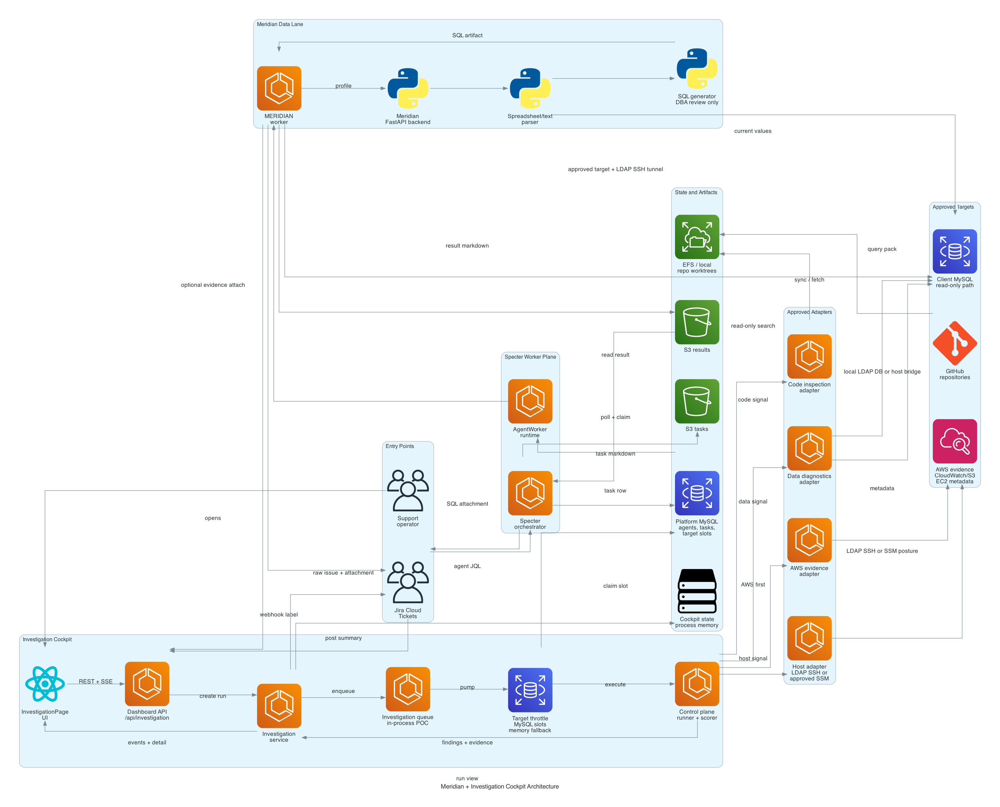
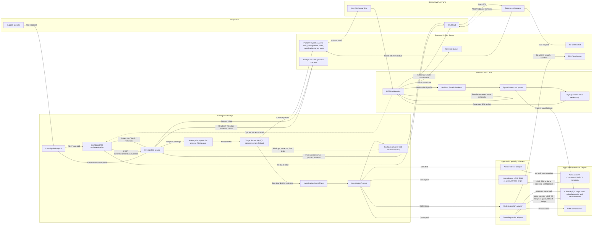

# Meridian and Investigation Cockpit Architecture Flow

This flow extends the existing Specter architecture shown in `specter_architecture.png`.
Specter already provides the worker pattern: Jira intake, MySQL work state,
S3 task/result payloads, EFS/shared repositories, and ECS workers. Meridian and
Investigation Cockpit add an attended investigation plane on top of that pattern.

Primary meeting diagram:



Regenerate it with:

```bash
python3 scripts/generate-meridian-investigation-cockpit-doc-diagram.py
```

## Architecture



## Investigation Cockpit Flow

1. A run starts from the Cockpit UI, a batch request, or a Jira webhook label.
   The default trigger label is `investigation-cockpit`.
2. `dashboard/server/routes/investigation.ts` validates the operator or webhook
   secret and calls `dashboard/server/services/investigation.ts`.
3. The service normalizes client, environment, mode, and ticket details. It then
   creates a queue message with a target key, max concurrency, dedupe id, and
   message group.
4. The current implementation uses an in-process queue with an SQS-compatible
   message shape for throttled local/POC execution.
5. A worker pump claims a target slot through `investigation_target_slots`.
   If MySQL throttle storage is unavailable, the service falls back to an
   in-memory POC throttle.
   The attended launcher uses a two-worker pool by default and accepts up to 10
   outstanding runs. Different client/environment target keys may run in
   parallel, while the PROD cap remains one active run per target key.
6. `InvestigationControlPlane` executes an `InvestigationRunner` run:
   AWS triage runs first, then code, data, and host adapters run only when
   scope or confidence signals justify them.
7. Adapters return structured findings, evidence, trace metadata, and telemetry.
   The service maps those into dashboard run state, analyzer status, audit
   entries, and Jira draft text.
8. The dashboard reads `/api/investigation/runs`, run details, findings,
   evidence, audit, health, and an SSE stream at
   `/runs/:runId/events/stream`.
9. An operator can approve, escalate, or post the redacted summary back to Jira.

## Local Operator Startup

Use this flow when running Investigation Cockpit locally with operator LDAP SSH
and optional AWS SSO-backed CloudWatch/S3 evidence access. Keep real tokens and
passwords out of committed files.

```bash
cd /path/to/cp-autonomous-ai-agents-platform

# Refresh the AWS SSO cache used by Cockpit AWS evidence adapters.
aws sso login --profile prod

# Optional: verify the refreshed profile before starting Cockpit.
# aws sts get-caller-identity --profile prod

# Jira ticket intake. Prefer shell exports or a local gitignored env file.
export JIRA_BASE_URL=https://your-domain.atlassian.net
export JIRA_USERNAME=operator@example.com
export JIRA_TOKEN='<jira-api-token>'
# Optional but preferred if Jira Environment is a custom field in the site.
# export INVESTIGATION_JIRA_ENVIRONMENT_FIELD_IDS=customfield_12345

# Cockpit AWS evidence access. Used for CloudWatch/S3 collection.
export INVESTIGATION_AWS_PROFILE=prod

# Operator LDAP SSH. Used for bounded Cockpit host/config probes. Cockpit DB
# diagnostics may also reuse these values when DB-specific credentials are not set.
export INVESTIGATION_OPERATOR_SSH_USER='<ldap-user>'
export INVESTIGATION_OPERATOR_SSH_PASSWORD='<ldap-password>'
export INVESTIGATION_SSH_PORT=22
export INVESTIGATION_CONFIG_PROBE_PATHS=/opt/software/medhok,/opt/software/medhok/batch

# Optional readonly DB target for Cockpit diagnostics / Meridian handoff.
# If DB username/password are omitted, the operator LDAP SSH values above can be
# reused by Cockpit runtime DB target fallback logic.
# export INVESTIGATION_DB_HOST=127.0.0.1
# export INVESTIGATION_DB_PORT=3306
# export INVESTIGATION_DB_USERNAME='<db-user>'
# export INVESTIGATION_DB_PASSWORD='<db-password>'
# If Cockpit DB diagnostics use an already-open local DB tunnel but Meridian
# should open its own LDAP SSH tunnel, keep INVESTIGATION_DB_HOST as the local
# endpoint and also provide the real remote DB endpoint plus SSH login host.
# export INVESTIGATION_SSH_HOST='client-prod-login.example.internal'
# export INVESTIGATION_DB_REMOTE_HOST='client-prod-replica-db.internal'
# export INVESTIGATION_DB_REMOTE_PORT=3306

# MERIDIAN worker standalone runs use these env names unless the target JSON
# explicitly points dbUser/secretRef at the Cockpit env vars above.
# export MERIDIAN_SSH_USER="$INVESTIGATION_OPERATOR_SSH_USER"
# export MERIDIAN_DB_USERNAME="$INVESTIGATION_OPERATOR_SSH_USER"
# export MERIDIAN_DB_PASSWORD="$INVESTIGATION_OPERATOR_SSH_PASSWORD"

PORT=3001 npm --prefix dashboard run dev:server
```

Notes:

- `aws sso login --profile prod` is not run by Cockpit. Operators refresh the
  SSO session before startup; Cockpit then passes `--profile prod` through AWS
  CLI calls.
- LDAP SSH host access does not use SSM. The AWS profile is still used for
  approved CloudWatch/S3 log-source collection.
- With `INVESTIGATION_AWS_INFER_HOST_TARGETS=true`, Cockpit can resolve the
  approved LDAP SSH host from AWS EC2 Name-tag discovery for the Jira
  client/environment scope. In that mode `INVESTIGATION_SSH_HOST` is only a
  manual override; Meridian receives the discovered `publicHost` through the
  Cockpit AWS evidence path.
- Static approved targets should carry the correct `awsProfile`. Jira-scoped
  runtime targets use `INVESTIGATION_AWS_PROFILE` or `AWS_PROFILE`.
- Cockpit derives the environment from Jira's Environment field first, then
  labels, then bounded ticket text. If the field is custom, set
  `INVESTIGATION_JIRA_ENVIRONMENT_FIELD_IDS`; otherwise Cockpit discovers Jira
  field metadata and caches it briefly.
- Cockpit derives CloudWatch regions from approved target/log-source config
  first, otherwise it checks enabled AWS regions through the SSO profile. Env IDs
  come from config first, then bounded Jira Environment values such as
  `WELLCARE---CP-PROD1`, which renders the `/CP/WELLCARE/PROD1/` prefix.
- If port `3001` is already in use, stop the old dashboard server or start with
  another `PORT`.

## Meridian Flow

1. The Specter orchestrator assigns a Jira task to the `MERIDIAN` agent through
   the normal `task_management` / worker flow.
2. `MERIDIANWorker` bypasses the generic task-description LLM path. It fetches
   raw Jira fields and spreadsheet attachments directly because Meridian owns
   its own PHI/PII handling.
3. In the normal queue-backed worker path, the worker resolves an approved target
   from `MERIDIAN_TARGETS_JSON` or `MERIDIAN_TARGETS_FILE`, then resolves
   credentials from runtime environment variables or target `env://...`
   references. MERIDIAN DB access requires
   `networkPath: "ssh_public"`, `sshAllowed: true`, `ssmAllowed: false`,
   `sshAuthMode: "operator_ldap"`, an approved SSH host, and a `remoteHost`.
   Standalone MERIDIAN runs use `MERIDIAN_SSH_USER` / `MERIDIAN_DB_*` or the
   Cockpit `INVESTIGATION_SSH_USER` / `INVESTIGATION_DB_*` env names.
4. The worker opens an operator LDAP SSH local port-forward to the target
   database. SSM is not used for Meridian DB access. It starts the packaged
   Meridian FastAPI backend when `MERIDIAN_API_BASE_URL` is not configured.
5. The worker creates and activates a per-task Meridian connection profile using
   a temp `MERIDIAN_PROFILES_DIR`.
6. The backend parses spreadsheets or ticket text, loads live field mappings,
   blocks configured PHI target columns, resolves current values through the DB,
   and generates SQL.
7. Meridian does not execute generated DML. It returns SQL for human DBA/operator
   review, and the Specter orchestrator posts the result and SQL attachment back
   to Jira.
8. Cleanup removes the connection profile, stops the LDAP SSH tunnel, deletes temp
   attachments, and stops the local backend when it was auto-started.

`task_management` is a Specter platform queue table only. It is never created in
or read from the client/RUD database. Investigation Cockpit only creates or
reuses a MERIDIAN work item through the platform handoff service; the
MERIDIAN worker owns Jira re-fetch, spreadsheet download, LDAP SSH tunneling,
client DB connectivity, read-only validation, and SQL artifact attachment.
For local Cockpit testing when platform MySQL is unavailable, the explicit
`INVESTIGATION_MERIDIAN_DIRECT_FALLBACK=true` flag may start a direct local
MERIDIAN run. When no explicit `MERIDIAN_TARGETS_JSON` or
`MERIDIAN_TARGETS_FILE` is configured, Cockpit derives a single-use MERIDIAN
target from the already selected Cockpit client/environment scope plus
`INVESTIGATION_DB_*` and `INVESTIGATION_SSH_*` runtime env. That fallback still
uses MERIDIAN target controls and LDAP SSH for remote DB endpoints. If the
Cockpit DB host is loopback, such as an already-open local operator tunnel at
`127.0.0.1`, the direct fallback may mark the target `networkPath:
"direct_local"` and reuse that local DB endpoint without opening a second SSH
tunnel. To make Meridian open the DB tunnel itself while Cockpit still uses a
local tunnel, set `INVESTIGATION_SSH_HOST` or `SSH_MASTER_HOST` plus
`INVESTIGATION_DB_REMOTE_HOST`; in that mode Cockpit derives an LDAP SSH
Meridian target with `remoteHost` set to the remote DB endpoint and ignores
`INVESTIGATION_DB_LOCAL_PORT` for Meridian. Production should keep the
queue-backed `task_management` path.

## Meridian Into Cockpit

The current Cockpit integration point is:

```text
POST /api/investigation/runs/:runId/meridian/evidence
```

That endpoint:

- attaches Meridian evidence and findings to an existing Cockpit run
- marks relevant analyzers complete
- updates summary, recommendation, confidence, Jira draft, audit, and events
- redacts secrets and PHI-like key/value text before display
- accepts only read-only `SELECT` or `WITH` SQL in displayed trace steps
- keeps the approval text explicit: Meridian attached read-only evidence only;
  no database write was performed

Important distinction: the MERIDIAN worker can generate DML SQL for DBA review,
but Cockpit trace SQL is constrained to read-only evidence display. Generated
DML should remain an attachment or Jira review artifact, not a Cockpit
diagnostic trace.

## Trust Boundaries

- Cockpit control plane: owns run state, dispatch, correlation, audit, and Jira
  summary workflow.
- Capability adapters: own narrow, approved access to AWS, host, DB, and code
  targets.
- Meridian worker: owns Jira attachment parsing, target DB tunnel setup, live
  value lookup, and SQL generation.
- Client DB: accessed only through approved targets, LDAP SSH/private paths, and
  read-only diagnostics unless a human DBA later executes reviewed SQL outside
  the autonomous flow.
- Human operator: approves Jira posting, escalation, and any SQL remediation.

## Current Scope Notes

- Cockpit run/evidence/findings are currently held in process memory in
  `dashboard/server/services/investigation.ts`; durable Cockpit history is not
  part of the current attended scope.
- The current service uses an in-process queue with a compatible message shape
  and target-slot throttling.
- Meridian evidence is attachable to Cockpit, but generated DML remains a Jira
  review artifact for DBA/operator review, not a Cockpit diagnostic trace.
- The Data Diagnostics adapter and Meridian backend are separate data lanes:
  query-pack diagnostics for Cockpit, SQL-generation workflow for Meridian.
